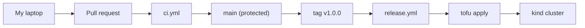

# Capstone · `ranbirsingh0091/turiba-devops-labs`

The course todo app, from a commit to a running cluster: Compose on my laptop, CI on every pull request, a release from a tag, and Helm on a kind cluster that OpenTofu builds.

## Run it from zero

Tested on 27 Nov 2026 in a new folder with no kind clusters, on Windows 11 with WSL (Ubuntu) and Docker Desktop.

**You need:** Docker, kind, kubectl, Helm and OpenTofu.

```bash
# 1 · Get the code
git clone https://github.com/ranbirsingh0091/turiba-devops-labs.git
cd turiba-devops-labs

# 2 · The whole app on this laptop, with Compose
cp .env.example .env
docker compose up -d
docker compose ps

# 3 · The cluster, from code
cd infra
tofu init
tofu apply -auto-approve
kubectl -n course get pods

# 4 · Use the app on the cluster
kubectl -n course port-forward service/api 8081:80 &
curl -s -X POST -H 'Content-Type: application/json' -d '{"title":"hello"}' localhost:8081/api/todos
curl -s localhost:8081/api/todos

# 5 · Clean up
tofu destroy -auto-approve
cd .. && docker compose down
```

A rebuild with `tofu destroy` and then `tofu apply` took 1m50s. The image used is `ghcr.io/ranbirsingh0091/turiba-devops-labs/api:1.0.0`.

## Architecture



Every change starts on a branch and reaches `main` only through a pull request, and only when the required checks are green. A tag `v1.x.y` on `main` starts `release.yml`, which builds the API image for `amd64` and `arm64`, pushes it to GHCR and creates the GitHub Release. The Helm chart in `charts/course-app/` names that exact image tag. `tofu apply` in `infra/` builds the kind cluster, creates the Namespace and the database Secret, and installs the chart.

## What is where

| Path | What it is |
|------|------------|
| `api/Dockerfile` | Multi-stage build of the API (Lab 2) |
| `compose.yaml` | The app on my laptop: `db`, `api` and `web` (Lab 4) |
| `web/nginx.conf` | The front end's proxy to the API (Lab 4) |
| `.github/workflows/ci.yml` | CI: `lint`, `unit`, `integration`, `image` |
| `.github/workflows/release.yml` | The multi-arch image and GitHub Release (Lab 6) |
| `k8s/` | Plain manifests from Missions 7–8 |
| `charts/course-app/` | The Helm chart (Mission 9) |
| `infra/` | OpenTofu: the kind cluster, Namespace, Secret and chart (Mission 10) |
| `lab1/` … `lab10/` | My mission write-ups |

**Course files I used:** None.

## Level and evidence

I claim **Minimum**.

| Item | Evidence |
|------|----------|
| M1 · Containers | [api/Dockerfile](https://github.com/ranbirsingh0091/turiba-devops-labs/blob/main/api/Dockerfile) · [compose.yaml](https://github.com/ranbirsingh0091/turiba-devops-labs/blob/main/compose.yaml) |
| M2 · Version control | [ruleset](https://github.com/ranbirsingh0091/turiba-devops-labs/rules) · [closed PRs](https://github.com/ranbirsingh0091/turiba-devops-labs/pulls?q=is%3Apr+is%3Aclosed) |
| M3 · CI | [ci.yml](https://github.com/ranbirsingh0091/turiba-devops-labs/blob/main/.github/workflows/ci.yml) · [Actions](https://github.com/ranbirsingh0091/turiba-devops-labs/actions) |
| M4 · Release 1.0.0 | [v1.0.0](https://github.com/ranbirsingh0091/turiba-devops-labs/releases/tag/v1.0.0) · [GHCR image](https://github.com/ranbirsingh0091/turiba-devops-labs/pkgs/container/turiba-devops-labs%2Fapi) |
| M5 · Helm | [values.yaml](https://github.com/ranbirsingh0091/turiba-devops-labs/blob/main/charts/course-app/values.yaml) · [PR #28](https://github.com/ranbirsingh0091/turiba-devops-labs/pull/28) |
| M6 · No secrets | I never committed a password. My `.gitignore` protects the state file. |
| M7 · This file | Tested on 27 Nov |

## When it breaks

| Fault | What you see | The command that shows the cause |
|-------|--------------|----------------------------------|
| The image tag in `values.yaml` doesn't exist on GHCR | A new API Pod in `ErrImagePull` | `kubectl -n course describe pod -l app=api` |
| The database password is missing or the Secret is wrong | `CreateContainerConfigError` or `Init:0/1` | `kubectl -n course describe pod -l app=db` |
| The Service selector doesn't match the Pod labels | `port-forward` prints nothing | `kubectl -n course get endpointslices -l kubernetes.io/service-name=api` |

## Known issues

- **T2 and T3 are not done.** I focused on the Minimum.
- **The `web` front end runs only in Compose.**

## AI use

I used an AI chat assistant to help with the commands and to verify the terminal output. I wrote the workflows and ran every command in `## Run it from zero` myself.
